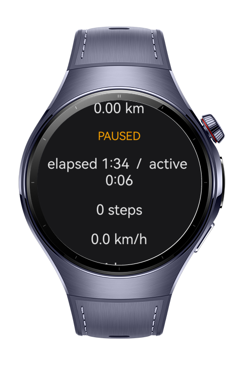

# WorkoutCore Sample

A single-screen wearable app that shows how to use the [`@explore-in-hmos/workoutcore`](../README.md) library. It is intentionally small: permissions, a config, a few callbacks and a column of numbers.



## What it demonstrates

- Requesting the sensor, health and location permissions the library needs.
- Building a `TrackingConfig` for `SportType.RUNNING` with `TrackingConfigBuilder`.
- Wiring `TrackingClient` into an `@ComponentV2` page.
- Receiving live `TrackingUpdate` values with `onUpdate` and rendering distance, elapsed and active time, steps, speed and heart rate.
- Starting, pausing, resuming and stopping a session from the watch screen.

## The app

The screen is `entry/src/main/ets/pages/Index.ets`. It creates one `TrackingClient`, calls `init()` with a running config in `aboutToAppear()`, copies the fields it shows into `@Local` state and stops the client in `aboutToDisappear()`.

Buttons drive the session:

| Button | Call |
|---|---|
| Start | `client.start()` |
| Pause / Resume | `client.pause()` / `client.resume()` |
| Stop | `client.stop()` |

The page shows distance in kilometres, recording or paused state, elapsed and active time, step count, current speed in km/h and current heart rate. Errors from `onError` are stored in `error` state, ready to be shown by the app.

## Tech stack & requirements

- HarmonyOS 6.1.1 (API 24) SDK
- ArkTS, stage model
- DevEco Studio 6.1 or newer, or the HarmonyOS command-line tools
- `ohpm` for dependencies
- A `wearable` device or emulator

The app module requires these permissions, declared in `entry/src/main/module.json5`:

- `ohos.permission.ACCELEROMETER`
- `ohos.permission.ACTIVITY_MOTION`
- `ohos.permission.GYROSCOPE`
- `ohos.permission.READ_HEALTH_DATA`
- `ohos.permission.LOCATION` and `ohos.permission.APPROXIMATELY_LOCATION`

## Project structure

```
AppScope/                         app-level name, icons and resources
entry/                            sample application (entry HAP)
  src/main/ets/pages/Index.ets    the workout screen
  src/main/ets/util/PermissionUtil.ets
  src/main/module.json5           abilities and requested permissions
WorkoutCore/                          the published library (HAR)
  Index.ets                       public API
  src/main/ets/api                TrackingClient and config
  src/main/ets/domain             tracking, filters, sports, swim
  src/main/ets/source             GPS, pedometer, motion and heart rate
  README.md                       library documentation
build-profile.json5               app products and modules
oh-package.json5                  project dependencies
```

## Getting started

Install dependencies:

```
ohpm install --all
```

Open the project in DevEco Studio and run the `entry` module on a wearable, or build from the command line:

```
hvigorw assembleHap --mode module -p module=entry@default -p product=default
```

The library is consumed from source through the local file dependency in `entry/oh-package.json5`:

```json5
"dependencies": {
  "@explore-in-hmos/workoutcore": "^1.0.0"
}
```

Replacing it with `ohpm install @explore-in-hmos/workoutcore` switches the sample to the published package.

## ArkTS notes

- The page uses state management V2: `@ComponentV2` with `@Local`. `TrackingUpdate` is a plain interface, so assign its fields to `@Local` variables instead of assigning the whole object.
- `onUpdate` passes the same `TrackingUpdate` instance each time; field-by-field assignment keeps the UI reactive.
- `onUpdate` and `onError` replace the previous listener rather than adding another one.
- Keep a `TrackingClient` as a field, not inside `build()`, so the session survives re-renders.
- Call `client.stop()` in `aboutToDisappear()`; the library does not decide when the page goes away.
- Permission dialogs must be shown from the UI ability context; the sample does this in `PermissionUtil`.
- `TrackingConfigBuilder` validates values and throws on invalid input, so build the config once and reuse it.

## References

- HarmonyOS developer documentation: https://developer.huawei.com/consumer/en/doc/harmonyos-guides/
- OpenHarmony ohpm registry: https://ohpm.openharmony.cn/
- Library API and behaviour: [README.md](../README.md)

## License
This example app is provided for learning purposes. WorkoutCore itself is MIT-licensed by its authors.
